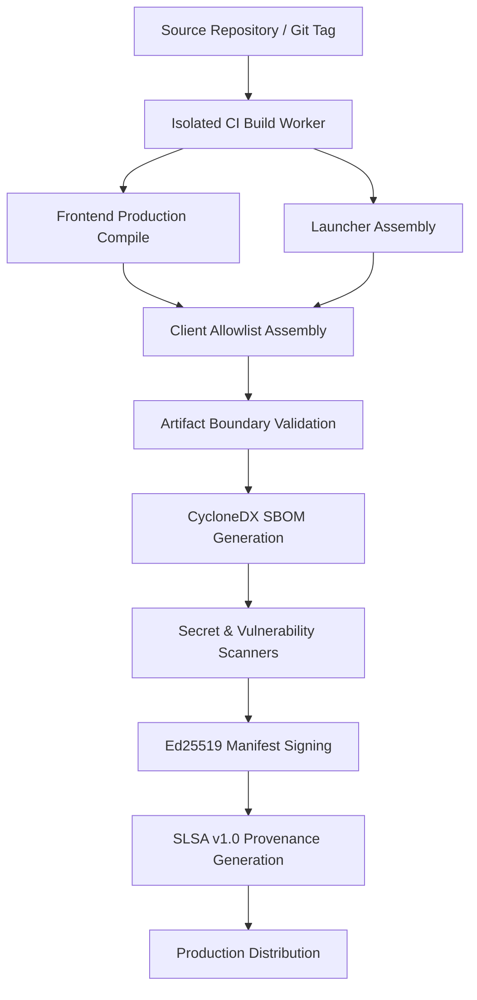

# Release Pipeline & Supply Chain Architecture

**Phase:** PROT-FINAL-04  
**Date:** 2026-11-18T03:48:37.665500+00:00  

---

## 1. Target Pipeline Architecture
The evaluation client build and verification pipeline follows strict separation-of-concerns:

## 2. Private Engine Isolation Invariant
The private reasoning engine (`src/core/`, `src/engine/`) is deployed exclusively to isolated private VPC infrastructure. It is strictly prohibited from entering the client assembly pipeline.
