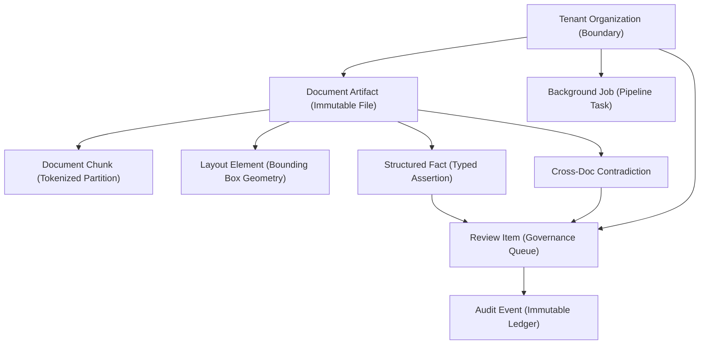

# AEGIS-DocIntel — Information Architecture

## 1. Domain Entity Hierarchy

The AEGIS user experience is organized around verified system entities:



## 2. Global Viewport Architecture

AEGIS Workbench 2.0 adopts a standardized 3-region grid:

1. **Top Header**:
   - Pinned 56px sticky bar.
   - Houses Tenant Switcher, Universal Command Palette (`Ctrl+K`), System Health Status, Notification Bell, and User Profile.
2. **Primary Navigation**:
   - Persistent left sidebar (260px expanded, 68px collapsed icon bar).
   - Groups routes into four functional tiers: *Workspace*, *Documents*, *Intelligence*, *Governance*, and *System*.
3. **Central Focus Stage**:
   - Fluid-width active workspace for data tables, query formulation, comparison matrices, and review cards.
4. **Contextual Inspector Panel**:
   - Resizable 420px drawer / split-pane providing in-context inspection (PDF viewer with bounding boxes, audit history, job diagnostics).

## 3. Navigation Group Structure

```
Workspace
├── Overview (/) ..................................... Operational Dashboard & System Status

Documents
├── Document Library (/documents) ................... Browse, filter & manage indexed documents
└── Document Inspection (/documents/[documentId]) ... Inspect chunks, layout & metadata

Intelligence
├── Ask AEGIS (/ask) ................................. Tri-pane grounded QA & token stream
├── Compare Documents (/compare) ..................... Cross-document fact & contradiction matrix
└── Evidence Explorer (/evidence) .................... [Planned] Cross-document evidence search

Governance
├── Review Queue (/reviews) .......................... Human governance task queue
└── Review Details (/reviews/[reviewId]) ............. Sovereign decision workbench & audit trail

System
├── Processing Jobs (/processing) .................... [Planned] Real-time pipeline monitor
├── Analytics (/analytics) ........................... [Planned] Telemetry, token economy & metrics
└── Settings (/settings) ............................. [Planned] Tenant, keys & preferences
```

## 4. State Management Tiers

- **Server State (TanStack Query)**: Centralized caching, automatic background invalidation, and optimistic mutations for all REST API resources, tagged by active tenant ID.
- **Session State (React Context)**: Authenticated user claims, verified active tenant, role boundaries, and theme preferences.
- **Local UI State**: Transient view states, modal open/close flags, active citation selections, and PDF zoom levels.
