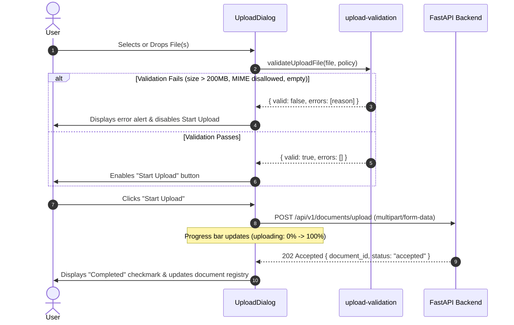

# 04 — Upload Experience

## 1. Upload Workflow Principles

The AEGIS Upload Experience (`features/uploads`) ensures sovereign data integrity before any bytes are transmitted across the network. It enforces pre-flight validation rules on the client, provides clear feedback during upload transmission, and explicitly distinguishes network upload completion from backend asynchronous indexing.

---

## 2. Pre-Flight Validation Policy (`UploadPolicy`)

Every file dropped or selected via the file picker is validated synchronously against `DEFAULT_UPLOAD_POLICY`:

| Constraint | Value | Error Message |
| :--- | :--- | :--- |
| **Max File Size** | 200 MB (`209,715,200` bytes) | `"The file exceeds the maximum allowed size."` |
| **Min File Size** | > 0 bytes | `"File cannot be empty (0 bytes)."` |
| **Allowed Formats** | PDF, DOCX, PPTX, HTML, TXT, XLSX | `"File type \"<type>\" is not supported."` |
| **Max Batch Size** | 10 files per upload session | `"Maximum 10 files allowed per upload session."` |

---

## 3. Upload Components

### 3.1 Dropzone (`UploadDropzone`)
- Accessible dropzone area styled with dashed border, icon, and explanatory text.
- Drag-and-drop state indicators (`drag-over` highlighting).
- Keyboard accessible "Browse files" button that triggers the hidden native file input.
- ARIA semantics: `role="region"`, `aria-label="File upload dropzone"`.

### 3.2 Progress Indicator (`UploadProgress`)
- Semantic progress bar using `role="progressbar"`, `aria-valuenow`, `aria-valuemin="0"`, and `aria-valuemax="100"`.
- Displays file name, percentage, and state text (`Uploading...`, `Completed`, or `Failed: <reason>`).
- Supports multi-file concurrent upload status tracking.

### 3.3 Modal Dialog (`UploadDialog`)
- Accessible modal dialog using `role="dialog"`, `aria-modal="true"`, and `aria-labelledby="upload-dialog-title"`.
- Focus trap handling and escape key dismissal.
- Staged file list allowing users to remove accidental files before initiating transfer.
- Start Upload trigger disabled until at least one valid file is present.
- Fully backward-compatible with legacy `UploadModalProps` via `web/src/features/documents/upload-modal.tsx`.
