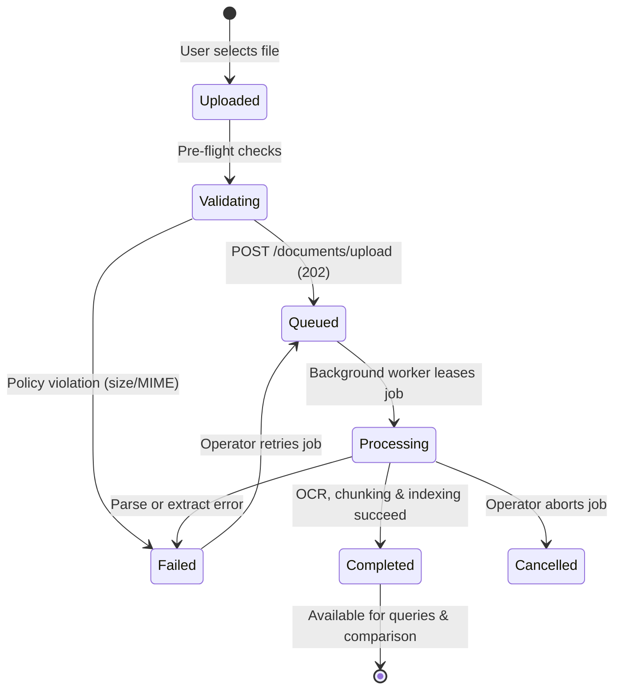

# 07 — Document Lifecycle & State Mapping

## 1. Lifecycle State Machine

A document transitions through distinct lifecycle states from initial client staging to long-term sovereign archival:

---

## 2. Bidirectional Backend-Frontend Status Mapping

The FastAPI backend expresses document status using `DocumentStatusEnum` (`pending`, `indexing`, `reindexing`, `ready`, `failed`). The frontend expresses user-facing lifecycle stages using `DocumentStatus` (`uploaded`, `queued`, `processing`, `completed`, `failed`, `cancelled`).

The adapter in `features/documents/api.ts` maps bidirectionally without loss of fidelity:

| Backend Status (`DocumentStatusEnum`) | Frontend Status (`DocumentStatus`) | Display Label | Badge Variant | Semantic Meaning |
| :--- | :--- | :--- | :--- | :--- |
| `ready` | `completed` | Completed | `success` | Document fully indexed and queryable |
| `indexing` | `processing` | Processing | `info` | Active text extraction and vector embedding |
| `reindexing` | `processing` | Processing | `info` | Re-running ingestion pipeline |
| `pending` | `queued` | Queued | `warning` | Awaiting background worker availability |
| `failed` | `failed` | Failed | `danger` | Parsing, extraction, or indexing failure |
| *(client-staged)* | `uploaded` | Uploaded | `default` | Transferred to server; awaiting queue registration |
| *(aborted)* | `cancelled` | Cancelled | `default` | Job canceled by operator |

---

## 3. Job Status Mapping

Background pipeline jobs map to the `JobStatusSchema`:

| Backend State (`JobStatusSchema`) | Frontend Type (`ProcessingJobStatus`) | Display Label | Badge Variant |
| :--- | :--- | :--- | :--- |
| `queued` | `queued` | Queued | `default` |
| `running` | `running` | Running | `info` |
| `retry_wait` | `retry_wait` | Retry Wait | `warning` |
| `succeeded` | `succeeded` | Succeeded | `success` |
| `failed` | `failed` | Failed | `danger` |
| `cancelled` | `cancelled` | Cancelled | `default` |
