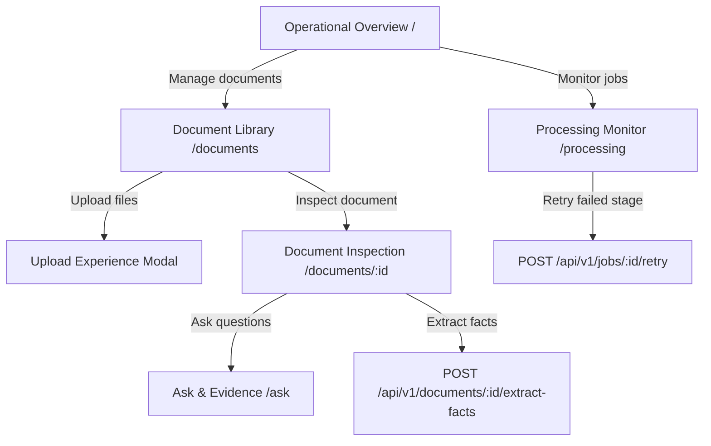

# WP-UI-04 — Core Workspace Architecture & Implementation

> **Work Package**: WP-UI-04: Core Workspace  
> **Status**: Completed / Ready for Review  
> **Date**: 9 November 2026  
> **Workstream**: UI/UX Engineering & Sovereign Document Intelligence  
> **Upstream Dependencies**: [WP-UI-01](../wp-ui-01-product-ux-architecture/README.md), [WP-UI-02](../wp-ui-02-design-system/README.md), [WP-UI-03](../wp-ui-03-application-shell/README.md)

---

## 1. Executive Summary

WP-UI-04 transforms AEGIS-DocIntel from a shell structure into a fully functional, production-ready document intelligence workspace. It delivers the primary operational environment where workspace analysts, document stewards, and sovereign operators manage source documents, monitor asynchronous pipeline telemetry, inspect extracted knowledge (chunks, metadata, and structured facts), and maintain operational visibility.

Every screen and interaction adheres strictly to existing backend REST capabilities verified in FastAPI (`contracts/API_ENDPOINT_INVENTORY.csv` and `contracts/openapi.yaml`). No fictional metrics endpoints were introduced; the operational dashboard metrics are dynamically composed from authentic live document registries (`/v1/documents`) and job telemetry systems (`/v1/jobs`).

---

## 2. Core Capabilities Delivered

1. **Operational Overview (`/`)**:
   - Live metrics summary: Total Documents, Processing, Completed, Needs Attention, and Queued.
   - Attention panel highlighting failed ingestion items and failed background jobs.
   - Activity feeds summarizing recent document ingests and processing jobs.
   - Quick capability jump cards preserving navigation entry points to Ask, Compare, and Review Queue.

2. **Document Library (`/documents`)**:
   - Searchable, filterable document registry table with pagination and sorting support.
   - Granular status filters: *All*, *Completed*, *Processing*, *Queued*, *Failed*.
   - Accessible action triggers, empty states with ingestion guidance, and error recovery alerts.

3. **Upload Experience (`features/uploads`)**:
   - Drag-and-drop dropzone with file picker fallback.
   - Client-side pre-flight policy enforcement (200MB max file size, strict MIME allowlists for PDF, DOCX, PPTX, HTML, TXT, XLSX).
   - Real-time progress tracking (`role="progressbar"`) separating upload from asynchronous indexing.
   - Registration confirmation and staged file management.

4. **Document Inspection (`/documents/[documentId]`)**:
   - Accessible tabbed inspection interface (`role="tablist"` / `role="tab"` / `role="tabpanel"`).
   - Tabs: *Overview*, *Preview*, *Extracted Text & Chunks*, *Extracted Facts*, *Metadata*, and *Processing Summary*.
   - Direct structured fact extraction trigger (`POST /api/v1/documents/{doc_id}/extract-facts`).
   - Deep passage verification with section headers, chunk identifiers, and grounded confidence displays.

5. **Processing Monitor (`/processing`)**:
   - Asynchronous job execution telemetry for background workers.
   - Status filters: *All*, *Running*, *Failed*, *Succeeded*, *Queued*.
   - Step-by-step pipeline timeline (`<ol role="list">`) with duration counters and error details.
   - One-click retry action for failed jobs (`POST /api/v1/jobs/{job_id}/retry`).

---

## 3. Work Package Documentation Index

| Document | Title | Description |
| :--- | :--- | :--- |
| [01](01-workspace-architecture.md) | Workspace Architecture | Blueprint and architectural integration of workspace subsystems |
| [02](02-operational-overview.md) | Operational Overview | Metrics aggregation, attention triage, and dashboard widgets |
| [03](03-document-library.md) | Document Library | Registry grid, filtering algorithms, search, and table accessibility |
| [04](04-upload-experience.md) | Upload Experience | Dropzone interaction, policy validation, progress, and confirmation |
| [05](05-document-inspection.md) | Document Inspection | Multi-tab inspection, chunk verification, and fact extraction |
| [06](06-processing-monitor.md) | Processing Monitor | Pipeline telemetry, timeline `<ol>` structure, and retry workflows |
| [07](07-document-lifecycle.md) | Document Lifecycle | State machine mapping between backend enums and frontend lifecycle |
| [08](08-functional-requirements.md) | Functional Requirements | Complete CW-FR-001–037 and CW-NFR-001–010 requirements register |
| [09](09-api-contract-mapping.md) | API Contract Mapping | Verified endpoints, query schemas, and backend gap mitigations |
| [10](10-security-and-data-handling.md) | Security & Data Handling | Tenant isolation, file validation, sanitization, and secure previews |
| [11](11-accessibility-and-responsive.md) | Accessibility & Responsive | WCAG 2.2 AA compliance, ARIA attributes, and breakpoint benchmarks |
| [12](12-test-plan.md) | Test Plan | Test strategy, unit test suite, and Playwright E2E test plan |
| [13](13-acceptance-criteria.md) | Acceptance Criteria | Detailed acceptance criteria verification matrix (CW-AC-01–14) |

---

## 4. Verification & Quality Record

- **Vitest Unit Test Suite**: 16 suites, 97 tests passing (100% pass rate).
- **Playwright E2E Suite**: 14 spec files, 46 tests passing across Desktop, Tablet, and Mobile viewports (100% pass rate).
- **TypeScript**: 0 errors (`tsc --noEmit`).
- **ESLint**: 0 errors, 0 warnings.
- **Turbopack Build**: Static & Partial Prerendering compilation succeeded.
