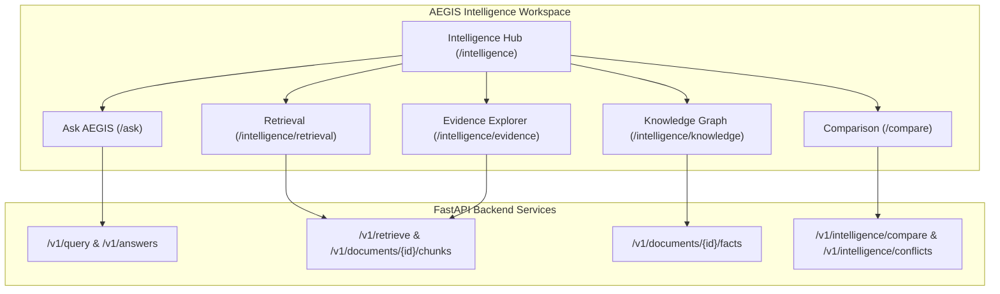

# 01 — Intelligence Workspace Overview

## 1. Executive Summary
The Intelligence Workspace transforms AEGIS-DocIntel from a document storage and indexing pipeline into a sovereign, traceable knowledge discovery workbench. It enables intelligence analysts, compliance auditors, and legal researchers to:
- Formulate natural language inquiries over ingested corporate and regulatory documentation.
- Inspect and query passages retrieved via hybrid search (BM25 lexical + dense embeddings).
- Examine verbatim ground truth passages with exact coordinate and page references.
- Explore entity-relationship graphs derived directly from extracted facts.
- Perform multi-document cross-comparison to detect factual variances and contradictions.

## 2. Core Architectural Pillars

## 3. User Personas & Workspace Responsibilities
1. **Intelligence Analyst (Primary)**:
   - Uses `/ask` for synthesis and query decomposition.
   - Drills down into `/intelligence/evidence` to audit whether citations legitimately support claims.
2. **Legal & Compliance Auditor**:
   - Uses `/compare` to evaluate multi-party agreements or version changes.
   - Submits detected conflicts into the Human Governance Review Queue (`/reviews`).
3. **Domain Researcher**:
   - Queries `/intelligence/retrieval` to evaluate ranking relevance.
   - Uses `/intelligence/knowledge` to explore cross-document entity networks.

## 4. Grounding & Anti-Hallucination Guardrails
- **No Fabricated Evidence**: Citations must map to verified documents and chunk identifiers.
- **Client-Side Integrity Verification**: The UI performs automated checks matching claim citations to returned citation arrays.
- **Transparent Safe Abstention**: If backend confidence is below the grounding threshold, the system displays an explicit "Safe Abstention: Insufficient Evidence" banner rather than fabricating an answer.
