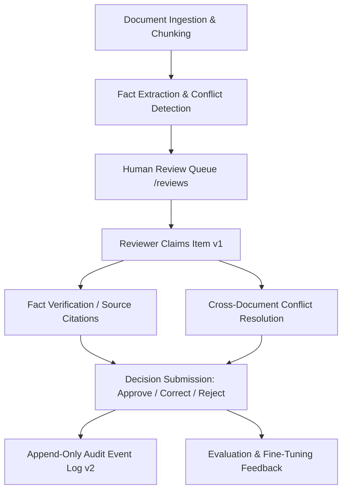

# 01 — Governance Workspace Overview

## 1. Context and Mission

In high-stakes enterprise document analysis (financial audits, regulatory compliance, legal diligence, medical records), automated AI extraction alone is insufficient for operational decisions. Errors, hallucinations, or unverified claims can lead to catastrophic legal or fiscal liability.

The **Governance Workspace** serves as the human oversight and verification layer of **AEGIS-DocIntel**. It provides authorized reviewers with the tools to:
1. Inspect candidate findings proposed by machine extraction engines.
2. Verify claims directly against cited source text passages.
3. Adjudicate conflicting assertions across disparate documents.
4. Issue binding governance decisions with explicit, audited rationale.
5. Maintain an append-only, tamper-evident audit history of all state changes.

---

## 2. Core Functional Pillars

### 2.1 Separation of Duties
Reviewers inspect and propose outcomes; decisions require authenticated human actors with explicit permissions. The UI explicitly forbids automated silent approvals.

### 2.2 Grounded Evidence-First Verification
Every extracted fact candidate must be linked to its source document ID, chunk ID, page number, and authoritative excerpt.

### 2.3 Concurrency Control & Optimistic Locking
To prevent race conditions when multiple reviewers work simultaneously, all decision mutations require matching `expected_version` values. If another reviewer has updated the item, HTTP 409 Conflict triggers a stale version alert, preventing blind overwrites.

### 2.4 Idempotency & Tamper-Evident Auditing
Every decision is assigned an idempotency key (`Idempotency-Key` HTTP header) to prevent duplicate commits upon network retries. Every successful state change appends a sequenced, immutable `AuditEvent` with actor ID, status diff, version diff, timestamp, and rationale.
