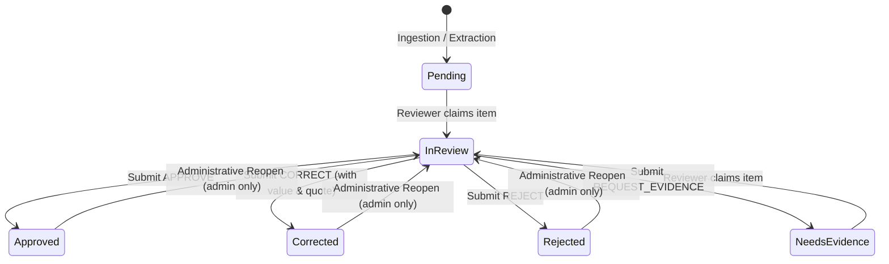

# 05 — Decision Management Specification

## 1. Overview and Route

- **Primary Route**: `/reviews/[reviewId]` (Tab: "Decision Management" and Overview quick actions)
- **Deep-Link Route**: `/reviews/[reviewId]/decisions`
- **Component**: `web/src/features/governance/components/DecisionPanel.tsx`

Decision Management is the formal transaction boundary of the human governance layer. It commits state transitions to the FastAPI backend with version concurrency, idempotency keys, and human compliance sign-off.

---

## 2. Decision Workflow & State Guardrails

---

## 3. Decision Actions

### 3.1 Approve (`approve`)
- Confirms the candidate fact or chosen claim matches source truth.
- Transitions item to `status: "approved"`, version increments by 1.
- Audit event logged with reviewer rationale.

### 3.2 Correct (`correct`)
- Replaces erroneous system inference with human-verified ground truth.
- Requires:
  - `corrected_value`: Human-entered string, number, or boolean.
  - `corrected_type`: Data type (`string`, `decimal`, `integer`, `boolean`, `date`).
  - `unit`: Optional unit (e.g. `USD`, `%`).
  - `evidence_quote`: Direct source excerpt grounding the correction.
- Creates an immutable `ReviewRevision` record.
- Transitions item to `status: "corrected"`, version increments by 1.

### 3.3 Reject (`reject`)
- Discards an ungrounded hallucination, spurious pattern, or refuted claim.
- Requires a substantive rationale (min 3 characters).
- Transitions item to `status: "rejected"`, version increments by 1.

### 3.4 Request Evidence (`request_evidence`)
- Flags the item for additional context retrieval or re-ocr/re-extraction.
- Transitions item to `status: "needs_evidence"`.

---

## 4. Human Oversight Certification

Before any formal decision can be submitted, the UI enforces:
1. **Rationale Input**: Non-empty, min 3 characters explaining the rationale.
2. **Certification Checkbox**: The reviewer must check:
   > *"I certify that I have verified the evidence citations and that this decision complies with governance policies."*
3. **Idempotency Protection**: A unique client-generated key (`idem-<timestamp>-<random>`) is transmitted in the `Idempotency-Key` header.
