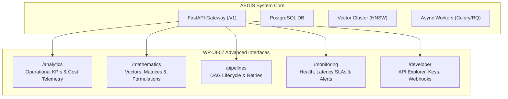

# 01 — Advanced Interfaces Overview

## 1. Architectural Mission
AEGIS-DocIntel is an enterprise-grade document intelligence system designed for sovereign human governance, regulatory compliance, and deep observable machine learning inference.

The objective of WP-UI-07 is to provide transparent operational observability and engineering interfaces that demystify complex document transformations, vector projections, and background pipelines.

## 2. Core Operational Constraints
1. **Verifiable Data Only**: In contrast to synthetic dashboard demos, all interfaces connect to actual REST APIs. No simulated "random jitter" is introduced.
2. **Honest Null Semantics**: Missing measurements return `null` or explicit `N/A` statuses. Zero is reserved strictly for genuine zero-valued telemetry.
3. **Enterprise Defense**: Export mechanisms prevent spreadsheet formula injection. Integration endpoints enforce strict SSRF protection rules.
