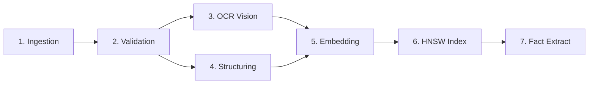

# 04 — Pipeline Visualization Specification

## 1. Functional Scope
The Pipeline Visualization Workspace (`/pipelines`, `/pipelines/[runId]`) models background document ingestion, extraction, and indexing lifecycles as a Directed Acyclic Graph (DAG).

## 2. DAG Execution Lifecycle
The execution sequence comprises sequential and parallel stages:

## 3. Cycle Detection & Graph Sorting
Graph structures are verified using `hasDependencyCycle()` and `topologicalSort()` in `web/src/features/pipelines/utils/validate-graph.ts`.
- **Algorithm**: Three-color Depth First Search (DFS):
  - White (0): Unvisited
  - Gray (1): Currently exploring in call stack (if revisited, a cycle exists)
  - Black (2): Completed and verified acyclic
- **Safety**: Prevents recursive deadlocks and infinite loops during parallel worker task dispatching.

## 4. Execution Controls & Fault Recovery
1. **Interactive Inspection**: Selecting any stage reveals duration, worker ID, dependencies, and detailed error logs if failed.
2. **Authorized Retry**: Failed jobs with retry attempts remaining can be re-queued via `POST /v1/jobs/{job_id}/retry`.
3. **Cancellation**: In-flight long-running jobs can be safely cancelled via `POST /v1/jobs/{job_id}/cancel`.
