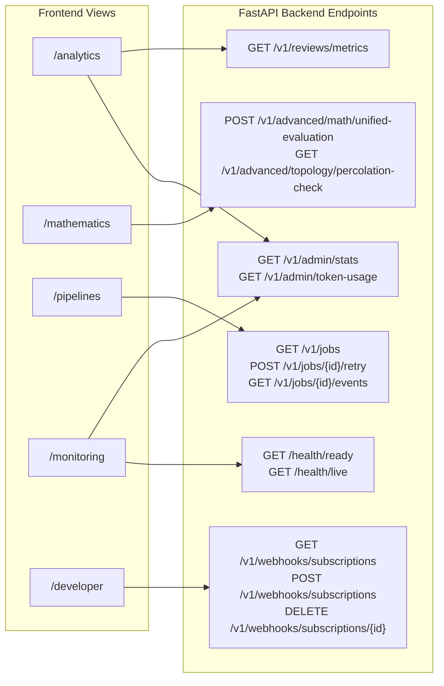

# 12 — API Integration Mapping

## 1. Backend Router Alignment
Every UI screen maps directly to verified FastAPI backend routes defined in `src/api/routers/`:

## 2. Invariant: Honest Fallbacks
When offline or encountering network partitions, components present explicit error boundaries (`ErrorState`) or deterministic mock fallback contracts rather than crashing the client session.
