# WP-UI-08: Scope & Objectives

## 1. Context and Mission

WP-UI-08 serves as the culminating integration, quality assurance, accessibility certification, and release-validation work package for the AEGIS-DocIntel web application.

Over the course of WP-UI-01 through WP-UI-07, the product architecture evolved systematically:
- **WP-UI-01**: Product UX Architecture (personas, information architecture, routes, permission matrix).
- **WP-UI-02**: Design System (tokens, primitives, typography, theme system, WCAG standards).
- **WP-UI-03**: Application Shell (sidebar, header, breadcrumbs, search, notification system, workspace selector).
- **WP-UI-04**: Core Workspace (documents library, upload workflows, processing monitor, workspace overview).
- **WP-UI-05**: Intelligence Workspace (Ask AEGIS, grounded Q&A, citations, cross-document comparison).
- **WP-UI-06**: Governance Workspace (review queue, fact verification, conflict resolution, sovereign human decisions, audit history).
- **WP-UI-07**: Advanced Interfaces (analytics, mathematical formulations, DAG pipeline execution, service telemetry, developer platform).

WP-UI-08 does not invent new screens. It establishes the rigorous connective tissue, ensuring all components communicate with real backend APIs, enforce workspace isolation, handle real-time streaming updates, meet strict accessibility requirements, and pass automated browser testing.

---

## 2. Five Pillars of WP-UI-08

```mermaid
flowchart TD
    subgraph P1["Pillar 1: System Integration"]
        A1["Unified API Layer"] --> A2["Context Propagation (X-Workspace-ID)"]
        A2 --> A3["Centralized Error Hierarchy"]
    end

    subgraph P2["Pillar 2: Security & RBAC"]
        B1["JWT / Dev Token Auth"] --> B2["7 Backend Roles / 23 Permissions"]
        B2 --> B3["Client-side Route Guards & PermissionGate"]
    end

    subgraph P3["Pillar 3: Real-Time Stream"]
        C1["WebSocket / SSE Manager"] --> C2["Bounded LRU Deduplication"]
        C2 --> C3["Exponential Backoff Reconnection"]
    end

    subgraph P4["Pillar 4: UX & A11y Verification"]
        D1["axe-core WCAG 2.2 AA Audits"] --> D2["6-Viewport Responsive Audits"]
        D2 --> D3["Interactive Playwright E2E Journeys"]
    end

    subgraph P5["Pillar 5: Release Certification"]
        E1["Clean Turbopack Build"] --> E2["Zero Defect Release Gate"]
        E2 --> E3["Release Decision: GO"]
    end
```

---

## 3. Scope Boundaries & Constraints

1. **Zero Data Fabrication**: All UI visualizations and metrics must bind directly to authentic backend contracts (`/v1/documents`, `/v1/jobs`, `/v1/query`, `/v1/reviews`, `/v1/admin/stats`, `/health/ready`). When backend telemetry is unavailable or loading, explicit empty or loading states must render without generating random or mock values.
2. **Authority of Backend Authorization**: While the frontend provides responsive UX by evaluating granted permissions through `PermissionGate` and `checkRouteAccess`, the FastAPI backend remains the ultimate authority for authorization.
3. **WCAG 2.2 Level AA Invariant**: Zero critical or serious accessibility violations across all views.
4. **Layout Invariant**: Absolute zero page-level horizontal overflow across any viewport down to 320px width (`scrollWidth <= innerWidth`).
