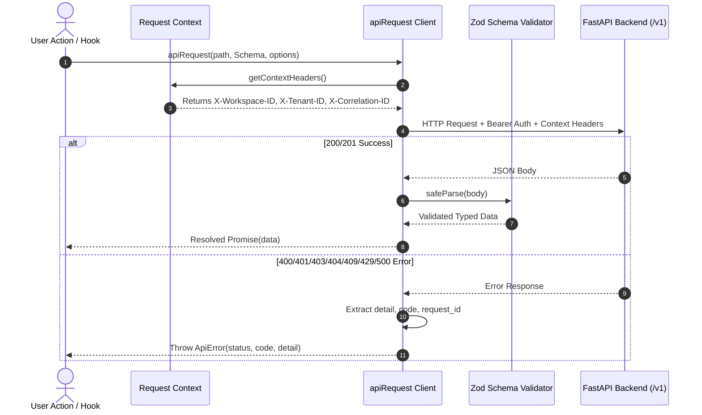

# WP-UI-08: Frontend-Backend Integration Layer

## 1. Architectural Strategy

Prior to WP-UI-08, various components utilized differing fetch implementations and error shapes. WP-UI-08 standardizes all communication through a single unified API client in `web/src/lib/api/`:

```text
web/src/lib/api/
├── client.ts             Standardized fetch wrapper with header injection & Zod validation
├── errors.ts             Structured ApiError hierarchy with status predicate helpers
├── request-context.ts    Thread-safe context propagation for headers
└── index.ts              Central barrel exports
```

---

## 2. Standardized Request Flow



---

## 3. Contextual Header Propagation

Every outgoing HTTP request automatically includes:
- `Authorization`: Bearer token (resolved via session or development bypass).
- `X-Workspace-ID`: Currently selected workspace ID (e.g. `workspace-default`).
- `X-Tenant-ID`: Active sovereign tenant identifier (e.g. `tenant-default`).
- `X-Correlation-ID`: Trace UUID (`corr-<timestamp>-<random>`) for cross-service tracing.

---

## 4. Centralized Error Hierarchy (`ApiError`)

The `ApiError` class standardizes HTTP failure representation across all frontend features:

| Predicate Helper | Status Code | Standard Response Meaning |
| :--- | :--- | :--- |
| `err.isUnauthorized` | `401` | Session expired, invalid JWT, or missing credentials |
| `err.isForbidden` | `403` | User authenticated but lacks required permission |
| `err.isNotFound` | `404` | Requested document, job, or review does not exist |
| `err.isConflict` | `409` | Optimistic locking version mismatch during decision submit |
| `err.isValidationError` | `422` | Request body or query parameters violate backend schema |
| `err.isRateLimited` | `429` | Request threshold exceeded; back off before retrying |
| `err.isServerError` | `>= 500` | Gateway, database, or worker service error |
