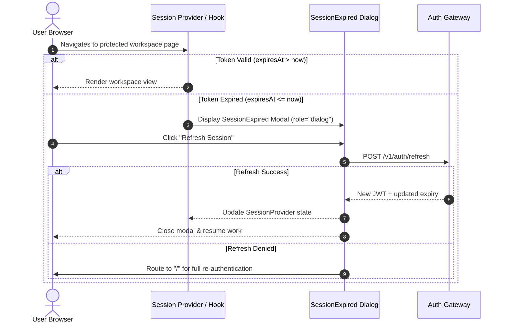

# WP-UI-08: Authentication & Session Management

## 1. Authentication Topology

AEGIS-DocIntel supports two distinct operating environments:
1. **Development & Testing Mode**:
   - Backend recognizes `Bearer dev-{tenant_id}` or `Bearer dev-token`.
   - Bypasses RS256 cryptographic signature checks.
   - Instantiates an active development session with all standard permissions.
2. **Production Sovereign Mode**:
   - Backend mandates RS256 signed JSON Web Tokens (JWT).
   - Requires valid `tenant_id`, `sub`, `roles`, `exp`, `iss`, and `aud` claims.
   - Session manager extracts decoded claims and maintains client-side expiration timers.

---

## 2. Session Architecture (`web/src/lib/auth/session.ts`)

```typescript
export interface UserSession {
  userId: string;
  tenantId: string;
  email?: string;
  displayName?: string;
  roles: readonly CanonicalRole[];
  permissions: readonly string[];
  expiresAt: number | null; // epoch timestamp in ms
  isAuthenticated: boolean;
  isDevBypass: boolean;
}
```

### Core Capabilities
- **Token Resolution**: Retrieves token from session storage, cookies, or environment overrides.
- **Expiry Detection**: Computes `isExpired` by evaluating `Date.now() >= session.expiresAt`.
- **Cache Invalidation**: On `signOut()`, all authorization tokens, workspace identifiers, and request context headers are purged immediately to prevent token leaks.

---

## 3. Session Expiry & Re-authentication Flow


