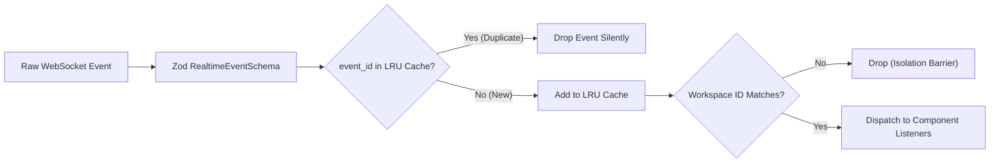

# WP-UI-08: Real-Time Stream Integration

## 1. Architectural Model

AEGIS-DocIntel provides live streaming updates for document processing stages, extraction jobs, governance claim locks, and telemetry updates. The client architecture is encapsulated in `web/src/lib/realtime/`:

```text
web/src/lib/realtime/
├── event-schema.ts       Standardized RealtimeEventSchema and event types
├── deduplicate.ts        Bounded LRU deduplication cache (1,000 max entries)
├── reconnect.ts          Exponential backoff strategy with jitter
└── connection.ts         RealtimeManager coordinating subscriptions
```

---

## 2. Event Lifecycle & Deduplication

In distributed networks, WebSocket and SSE connections may deliver duplicate events upon packet retransmission. To guarantee idempotent UI rendering, every event carries an `event_id` verified against an in-memory LRU ring buffer:



---

## 3. Exponential Backoff with Jitter

When a connection terminates unexpectedly, the `ReconnectStrategy` prevents server stampedes by applying exponential backoff:

$$t_{retry} = \min(t_{max}, t_{base} \times 2^{attempt}) \pm \text{jitter}$$

- **Base Delay**: 1,000 ms
- **Max Delay**: 30,000 ms
- **Max Retries**: 10 attempts
- **Jitter**: $\pm 20\%$ randomized window

---

## 4. Connection State UI (`ConnectionStatus.tsx`)

The application header features a live status indicator displaying:
- `connected`: `"Live Synced"` (emerald badge).
- `connecting`: `"Connecting..."` (amber badge).
- `reconnecting`: `"Reconnecting..."` (amber badge).
- `disconnected`: `"Disconnected"` with accessible manual retry trigger.
