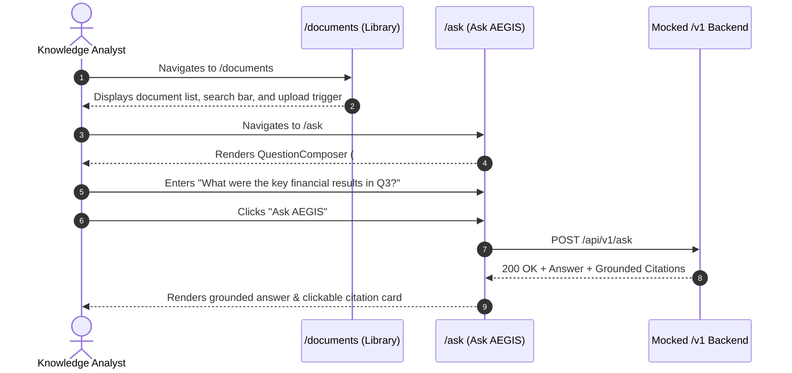
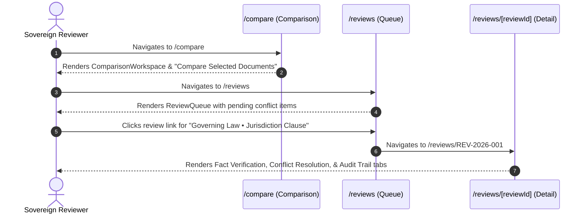

# WP-UI-08: Critical End-to-End User Journeys

## 1. Journey Overview

WP-UI-08 automates three end-to-end user journeys spanning all seven core product capability areas.

---

## 2. User Journey 1: Document Intelligence Workflow

**Goal**: Ingest and inspect source documents, navigate to Ask AEGIS, compose questions, and verify grounded answers with citation references.

- **Verified Selectors**: `main h1: Documents`, `#aegis-question`, button `Ask AEGIS`.
- **Validation**: Verified answer text `"The Q3 revenue grew by 18%"` and citation filename `"Financial_Report_Q3.pdf"`.

---

## 3. User Journey 2: Comparison & Governance Workflow

**Goal**: Cross-compare legal agreements, open conflicting review items in the governance queue, inspect fact verification, and verify sovereign audit history.

- **Verified Selectors**: `button: Compare Selected Documents`, `link: Governing Law`, `tab: Fact Verification`, `tab: Conflict Resolution`, `tab: Audit Trail`.
- **Validation**: Verified URL navigation, item state loading, and sovereign audit history preservation.

---

## 4. User Journey 3: Engineering & Operations Workflow

**Goal**: Verify system observability, numerical models, pipeline DAGs, service SLAs, and developer platform.

1. **Analytics (`/analytics`)**: Operational KPI cards and time range selector (`Last 7 Days`).
2. **Mathematics (`/mathematics`)**: High-dimensional vector viewer and matrix representation tabs (`Vectors & Matrices`, `Formulas & Equations`).
3. **Pipelines (`/pipelines`)**: Background processing execution explorer with status filters and search.
4. **Monitoring (`/monitoring`)**: System health dashboard with dependent service cards (`FastAPI Application Gateway`) and latency SLA percentiles.
5. **Developer Platform (`/developer`)**: API Credentials, API Explorer, and Webhooks.
